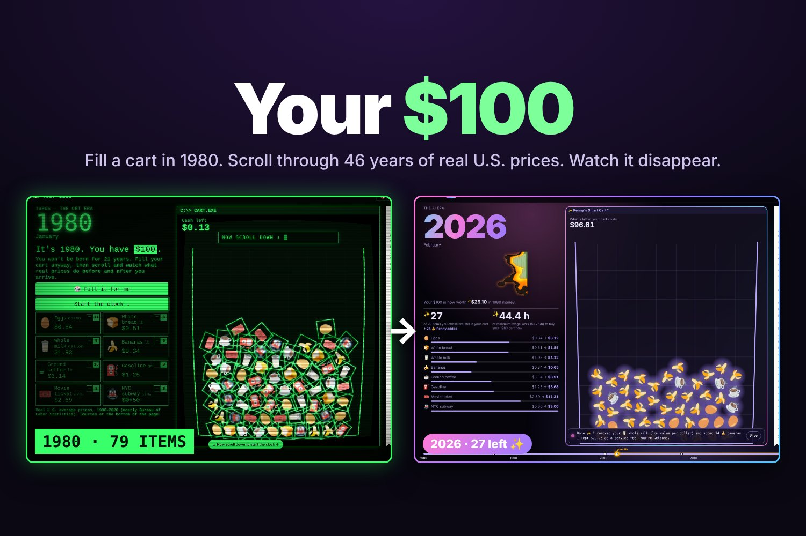

# 💵 Your $100



**It's 1980 and you have $100. Fill a shopping cart, then scroll through 46 years of real U.S. prices and watch inflation (and then AI) take it apart.**

▶ **Live site:** https://supersunny7.github.io/your-100/
📦 **Code:** https://github.com/Supersunny7/your-100

Built for the BuildyourOwnWebsite Hackathon 2026 (Devpost).

## How it works
0. **What year were you born?** A 1980 terminal asks one question first. Your birth year becomes part of the story: a full-screen "You were born" moment, life milestones (first grade, 13, 16, 18, 21, today) with real prices from that year, a "your life" band on the timeline, and a line on your final receipt.
1. **Shop in 1980.** Tap real 1980 groceries into a physics cart, or press 🎲 *Fill it for me*.
2. **Scroll = time.** Scrolling moves time forward month by month. Whenever your $100 can't cover the cart anymore, an item flies out with a *ka-ching* and the receipt prints what you lost and when. Items about to go start shaking; grab one with the mouse to hold on to it for a while. Your $100 bill burns at the rate the dollar lost value (CPI).
3. **History happens.** Black Monday, the dot-com crash, Lehman, the pandemic: each shows how much of your cart is left. When prices dip (gas in 2015, 2020), items come back, and the page tells you why.
4. **Nov 30, 2022: ChatGPT launches.** The page slowly turns into an AI product: sparkles, an "AI-optimized receipt", and in 2025 an AI shopping agent ("Penny") takes your cursor, swaps the item you bought most of for bananas and keeps a service fee. You can press **Undo**.
5. **The receipt.** It ends with a printed receipt comparing 1980 and today, plus the same cart in hours of minimum-wage work. Download it as a PNG or copy your result.

The page also drifts through web-design history as time passes: green CRT, Windows 95, glossy Web 2.0, flat design, dark mode, and finally the AI look (as parody). Even the mouse pointer changes with the era.

**Era Lens:** the cart is drawn through a WebGL shader that turns it into each era's display: a curved CRT tube with phosphor bloom and scanlines, 1990s pixels with ordered dithering, glossy 2000s plastic, and after ChatGPT a soft "hallucination" that follows your cursor. Text stays crisp HTML. Without WebGL the cart falls back to plain canvas.

Time is speed-limited (about 5 years per second) so a fast scroll can't skip the story, and big moments get a moment to land.

## Run it locally
It's a static site with no build step:

```bash
git clone https://github.com/Supersunny7/your-100
cd your-100
python3 -m http.server 8000   # then open http://localhost:8000
```

## Data
| What | Source | Notes |
|---|---|---|
| Eggs, white bread, whole milk, bananas, ground coffee, gasoline | U.S. Bureau of Labor Statistics, Average Price Data (via FRED) | Annual averages 1980–2025; 2026 = average of the months published so far; interpolated month to month. Milk before 1996 uses the half-gallon series, chain-linked to the gallon series. |
| Movie ticket | NATO / Cinema United average ticket price | Approximate: interpolated between the years listed in `js/data.js`. |
| NYC subway fare | MTA fare history | Each change on its real date. |
| Public college tuition | College Board, *Trends in College Pricing* | Approximate: interpolated. |
| Inflation (burning bill) | BLS CPI-U | Annual averages. |
| Minimum wage | U.S. Department of Labor | Federal minimum, by date of each change. |

All prices are U.S. city averages in U.S. dollars, not adjusted for inflation (that's the point).

## Tech
HTML, CSS and vanilla JavaScript; Matter.js for physics; a raw WebGL fragment shader for the cart's era lens; Web Audio for synthesized sounds (no audio files). Eras are blended live through CSS custom properties.

## Credits and disclosure
- **AI:** code and data research were done with help from Claude (Anthropic). "Penny" is a scripted parody of AI shopping assistants; no AI model is called by the site.
- **Libraries:** [Matter.js](https://brm.io/matter-js/) 0.19.0 (MIT license), included in `vendor/`.
- **Fonts:** Inter, JetBrains Mono, Montserrat and VT323 from Google Fonts (SIL Open Font License).
- **Emoji** are rendered by your system's emoji font.

## License
MIT. See [LICENSE](LICENSE).
